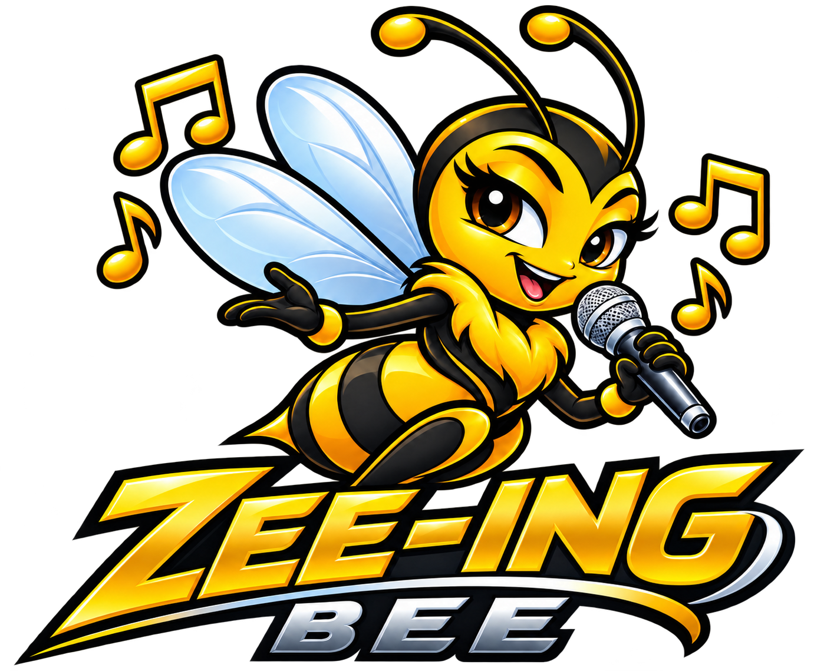

# Zee-ing Bee 🐝

Videoke at home, for Windows and macOS. Punch in a song number, sing to lyrics that colour as you go, and line up the next singer.

## Features

- **Song numbers and keypad.** Every song gets a five-digit number that never changes. Type it on the keypad or the keyboard and press Enter.
- **Reserve list.** Queue songs while someone sings; the next one starts on its own.
- **Videoke stage.** Two alternating lines that fill with colour syllable by syllable, a count-in before the first line, and a moving backdrop.
- **Key, tempo and guide melody.** Key ±6 semitones (↑/↓), tempo 50–150%, guide melody on or off.
- **Sound mixer.** Melody, bass, drums and band from 0 to 200%, plus echo and volume.
- **Your songs.** Add folders of `.kar`, `.mid` and `.midi` files. Name them `Title - Artist.kar`; subfolders become category chips. Search ignores accents and apostrophes.
- **Sound banks.** GeneralUser GS built in; add any `.sf2`, `.sf3` or `.dls`.
- **Printable songbook.** A PDF by category and by artist, with every number.

Search lists exact title, artist or song-number matches at the top, followed by suggested songs in a separate section.

## Keyboard

| Key | Does |
|---|---|
| 0–9, Backspace, Esc | Type, fix or clear a song number |
| Enter | Sing it now, or reserve it if a song is playing |
| Space | Pause / resume |
| ↑ / ↓ | Key up / down |

## Develop

This repository contains source code only. Song packs, videos, soundfonts, logos and icons under `src/assets/` and `resources/` are local-only and excluded from Git. Add your own song folders in the app, or place local packs and branding in those directories before building. Existing local files are preserved.

Needs Node.js 22 or newer.

```bash
npm install
node node_modules/electron/install.js   # npm 11 skips Electron's download step
npm run fetch-soundfont                 # GeneralUser GS, ~32 MB
npm run make-demo-songs
npm start
npm test
```

Smoke test (sings a song for a few seconds, prints the stage state, saves a screenshot):

```bash
ZB_SMOKE=/tmp/zb.png npm start
```

## Installers

- **Windows:** `npx electron-builder --win` makes `dist/Zee-ing Bee Setup <version>.exe`.
- **macOS:** `.dmg` files must be built on a Mac: run `npx electron-builder --mac` there.

The **Build installers** GitHub Action (`.github/workflows/installers.yml`) builds Windows x64 `.exe`, Apple Silicon `.dmg` and Intel Mac `.dmg` installers. It runs on pushes to `main`, pull requests, `v*` tags, and manually from **Actions → Build installers → Run workflow**. Downloads and SHA-256 checksums are saved as workflow artifacts for 30 days. Version tags also publish all three installers to a GitHub Release.

Edit `RELEASE_NOTES.md` before creating each version tag. Once all three builds succeed, the release job posts that file as the GitHub Release description and attaches the installers and checksums. Re-running a tagged build updates the same release notes and replaces its build files.

CI builds include the basic GeneralUser sound bank and its license. Private songs, videos, logos and icons are excluded. Google Drive asset downloads and the 10% early-use feature are deferred until the asset upload is configured.

The builds are unsigned for now. On Windows, SmartScreen shows "More info → Run anyway". On macOS, right-click the app → **Open** the first time, or run `xattr -cr "/Applications/Zee-ing Bee.app"`. Signing needs a code-signing certificate (Windows) and an Apple Developer ID (macOS).

### Auto-update

The installed app checks for a newer version in the background (about 15 seconds after launch, then every 4 hours), downloads it quietly, and shows a small "Restart & update" banner once it's ready — it never restarts on its own, so a song in progress is never interrupted. Updates come from GitHub Releases on this repo, on one of two separate channels baked into the build:

- **App only** (`latest` channel): the lean installer the CI workflow above builds and publishes automatically on every `v*` tag. Nothing extra to do — tag a release and it rolls out.
- **Full package** (`full` channel): your own local build with song packs, soundfonts and branding bundled in (`npm run dist:full`). CI never builds or publishes this — it contains your private assets, which aren't in this repo. To publish a new full-package version, set a `GH_TOKEN` with `repo` access to this GitHub repo and run `npm run publish:full`. It uploads to the *same* `vX.Y.Z` release as the app-only build, just under different file names, so both channels can coexist on one release without clashing. A build run from source (`npm start`) never checks for updates.

Auto-update works on unsigned Windows builds (no certificate needed). **macOS requires an Apple Developer ID certificate** — Apple's own update mechanism (Squirrel.Mac) refuses to install an update into an unsigned app, so on an unsigned Mac build the app will find an update but fail to install it; download the new `.dmg` from the Releases page instead until signing is set up. Building macOS for both Apple Silicon and Intel in CI also writes two separate update-feed files; merging them so one update feed correctly serves both Mac architectures is a follow-up, not yet done.

## Songs

Zee-ing Bee loads every ZIP song pack in `src/assets/packs` automatically. On first launch, packs are extracted into the app's user data folder; subsequent launches reuse the extracted files. Pack categories appear in the library alongside added folders. Installers include the packs. Use song files you have the right to use.

Playing a song opens a separate karaoke display while the dashboard keeps song selection, reservations and playback controls available. A second monitor is used automatically when connected. Use **Open display** to reopen the window and **F11** in the display for full screen.

The display checks YouTube on each online play for official music videos first, then Wish or other official live performances, ordered by newest upload within each group. It skips lyric-only videos, karaoke covers and unofficial reposts. Stalled videos get one recovery attempt before the app tries another source or background. A saved video plays immediately while checking for a newer match and remains available offline. Videos are always muted: the MIDI/KAR song remains the audio source. A random looping video from `src/assets/videos` plays when no matching playable video is available. Matching local videos named `Title - Artist.mp4` in `src/assets/music-videos` or added song folders take priority. Online search depends on YouTube's public search page and may need updating if that page changes. Live arrangements can differ in timing from MIDI arrangements. Source branding can be baked into videos; channel and title filters cannot detect every watermark.

After an online music video starts playing, the app automatically downloads an MP4 copy (up to 1080p when the source offers it, 600 MB max) into `music-videos` in its user data folder. It switches to the saved file when ready and uses that file on later plays, including offline. The dashboard shows **Video saved · Available offline** only after the download completes. If saving fails, streaming continues and the dashboard reports that the video is streaming only. The first download installs a checksum-verified yt-dlp helper from its official GitHub release. Downloads run one at a time; only songs you play are saved. Saved files stay until removed from the app's user data folder. Saved videos (with their original audio) appear under **Music videos** and power **Listen instead**; there is no separate download step, and **Listen instead** becomes available once the current song's video has saved.

Use **Find online karaoke** to add a song missing from the library. Enter its title and artist, choose a karaoke result, then select **Download & add**. The complete MP4 (including backing audio and on-video lyrics) is saved in `karaoke-videos` in the app's user data folder and receives a permanent song number under **Online Karaoke**. It can be searched, reserved and played offline like other songs. Existing title/artist matches are offered instead of downloading duplicates. These videos use their own backing audio; the separate display remains muted to prevent duplicate sound. MIDI-only key, guide and instrument-mixer controls are disabled for video songs; pause, stop, tempo and the reservation queue still work. The **INTRO** indicator for MIDI songs sits below the lyrics.

## Credits

- [SpessaSynth](https://github.com/spessasus/spessasynth_lib) (spessasynth_lib and spessasynth_core), Apache License 2.0: the synthesizer and MIDI engine.
- [GeneralUser GS](https://github.com/mrbumpy409/GeneralUser-GS) by S. Christian Collins, GeneralUser GS License v2.0: the built-in sound bank.
- [Electron](https://www.electronjs.org/) and [electron-builder](https://www.electron.build/), MIT License.
